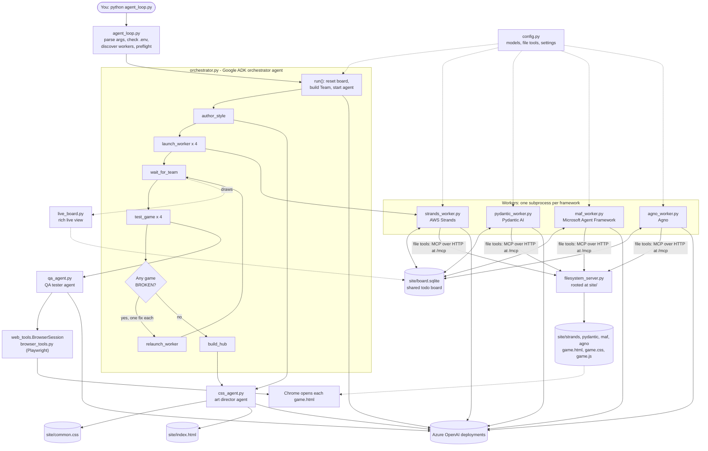
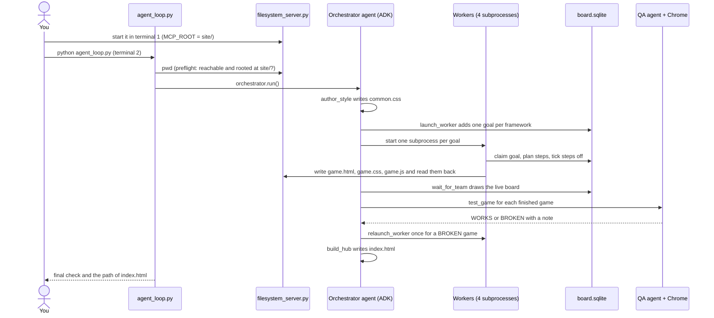

# Agent Loop: a language-arcade built by a team of agents

An orchestrator agent (Google ADK) leads four worker agents, each built on a different framework (AWS Strands, Pydantic AI, Microsoft Agent Framework and Agno). Given a language, it:

1. writes a shared house style (`common.css`),
2. gives each worker a different learning objective, and each worker **invents and builds its own browser game** (`game.html`, `game.css`, `game.js`),
3. shows the workers' progress live on a shared todo board,
4. plays every finished game in a real Chrome window with a QA agent and sends a broken game back for one fix,
5. writes a home page (`index.html`) linking all the games.

Everything runs on Azure OpenAI. The workers read and write files through your own MCP server, [filesystem_server.py](filesystem_server.py), which you start in a separate terminal.

## Architecture



### One run, step by step



The orchestrator is not a Python loop calling the workers. It is an agent with a goal and six tools (`author_style`, `launch_worker`, `wait_for_team`, `test_game`, `relaunch_worker`, `build_hub`); the agent makes the decisions and the tools do the mechanics. A plain-Python safety net (`_ensure_site`) writes a template style and home page if the agent stops early.

## Files

### In this folder (`5_agent_frameworks/5_agent_loop/`)

| File | What it does |
| --- | --- |
| [agent_loop.py](agent_loop.py) | Entry point. Parses arguments, checks `.env`, discovers workers, checks the file server, runs the orchestrator, prints the final check and opens the site. |
| [config.py](config.py) | **All configuration**: Azure settings, the orchestrator and worker deployments, the file server URL, and one model builder plus one file-tool builder per framework. |
| [catalog.py](catalog.py) | The worker manifest `WORKERS` (key, name, colour, script path) and how to launch a worker. |
| [orchestrator.py](orchestrator.py) | The ADK orchestrator agent, its six tools, the `Team` state, worker launching and timeouts, and the safety net. |
| [css_agent.py](css_agent.py) | The art director: authors `common.css` and `index.html`, with built-in templates as fallback. |
| [qa_agent.py](qa_agent.py) | The QA tester agent that plays one game in a browser and reports a verdict. |
| [web_tools.py](web_tools.py) | `BrowserSession`: the QA agent's browser tools, on a dedicated thread per check. |
| [browser_tools.py](browser_tools.py) | `BrowserTools`: the Playwright wrapper (copied from `4_langchain_langgraph`, plus `channel` and page-error capture). |
| [board.py](board.py) | The shared SQLite todo board (one file, one `todos` table, WAL mode). |
| [live_board.py](live_board.py) | The `rich` live view of the board, coloured per framework. |
| [filesystem_server.py](filesystem_server.py) | The sandboxed filesystem MCP server (streamable HTTP at `/mcp`). |
| [prompts.py](prompts.py) | Every prompt: game task, orchestrator, art director, QA and fix task. |
| [quiet.py](quiet.py) | Silences noisy library warnings so the live board stays readable. |
| `site/` | **Generated output** (git-ignored): `common.css`, `index.html`, `board.sqlite` and one folder per framework with its game. Rebuilt on every run. |

### From other folders

| File | Used for |
| --- | --- |
| [`../2_strands_pydantic/strands_worker.py`](../2_strands_pydantic/strands_worker.py) | The AWS Strands worker. |
| [`../2_strands_pydantic/pydantic_worker.py`](../2_strands_pydantic/pydantic_worker.py) | The Pydantic AI worker. |
| [`../3_maf_agno/maf_worker.py`](../3_maf_agno/maf_worker.py) | The Microsoft Agent Framework worker. |
| [`../3_maf_agno/agno_worker.py`](../3_maf_agno/agno_worker.py) | The Agno worker. |
| `../2_strands_pydantic/board.py`, `../3_maf_agno/board.py` | Each worker imports the `board.py` next to it (identical to this folder's copy). |
| `../../.env` | Your secrets and deployment names (git-ignored; template: `../../.env.example`). |
| `../../requirements.txt` | The Python packages. |

Each worker script runs as its own process, started by the orchestrator as `python <worker>.py <task id> <board path>`. It adds this folder to its import path to use [config.py](config.py), so its model and file tools come from one place. The lab notebooks beside the workers (`strands_lab.ipynb`, `pydantic_lab.ipynb`, `maf_lab.ipynb`, `agno_lab.ipynb`) show how each framework was first set up.

## What `config.py` provides

| Function | Framework | What it builds |
| --- | --- | --- |
| `adk_model()` | Google ADK | A LiteLLM `azure/<deployment>` model for the orchestrator, art director and QA agent. |
| `strands_model()` / `strands_filesystem()` | AWS Strands | `OpenAIModel` on an `AsyncAzureOpenAI` client / an `MCPClient` over streamable HTTP. |
| `pydantic_model()` / `pydantic_filesystem()` | Pydantic AI | `OpenAIChatModel` on an `AsyncAzureOpenAI` provider / an `MCPToolset`. |
| `maf_client()` / `maf_filesystem()` | Microsoft Agent Framework | `OpenAIChatClient` routed to the Azure endpoint / the server's tools as function tools (see Design notes). |
| `agno_model()` / `agno_filesystem()` | Agno | `OpenAIChat` on an `AsyncAzureOpenAI` client / `MCPTools` over streamable HTTP. |

Framework imports happen inside these functions, so each worker loads only its own framework.

## Prerequisites

- **Python** with the packages from `requirements.txt` installed in the interpreter you run with. This was tested on Python 3.12 with `google-adk 2.9.1`, `strands-agents 1.56.0`, `pydantic-ai 2.31.1`, `agent-framework-core 1.19.0`, `agent-framework-openai 1.14.4`, `agno 3.0.10`, `mcp 2.1.1`, `fastmcp 4.0.5`, `litellm 1.101.0` and `playwright 1.62.0`.
- **Google Chrome** installed. The QA browser launches the installed Chrome, so Playwright's bundled Chromium is not needed.
- **Azure OpenAI** deployments for the orchestrator and the workers.
- A `.env` file at the repository root (copy `.env.example`).

### `.env` settings

| Variable | Needed | Meaning |
| --- | --- | --- |
| `AZURE_OPENAI_API_KEY` | yes | Azure OpenAI key. |
| `AZURE_OPENAI_ENDPOINT` | yes | Azure OpenAI endpoint. |
| `AZURE_OPENAI_API_VERSION` | yes | api-version for the workers' clients, for example `2024-12-01-preview`. |
| `AZURE_OPENAI_DEPLOYMENT_GPT_56_SOL` | yes | Deployment the orchestrator, art director and QA agent use. |
| `AZURE_OPENAI_DEPLOYMENT_GPT_55` | yes, unless `WORKER_MODEL` is set | Deployment the four workers use. |
| `WORKER_MODEL` | no | Overrides the worker deployment, for example to run cheaper. |
| `AZURE_OPENAI_ADK_API_VERSION` | no | api-version for the ADK model. Default `2025-04-01-preview`; Azure's Responses API, which tool calls use, needs `2025-03-01-preview` or newer. |
| `FILESYSTEM_MCP_URL` | no | Where the file server listens. Default `http://127.0.0.1:8000/mcp`. |
| `QA_HEADLESS` | no | `1` hides the QA browser window; otherwise you can watch each game being played. |
| `WORKER_TIMEOUT_S` | no | Seconds before a worker is stopped. Default 300. |
| `QA_TIMEOUT_S` | no | Seconds before a QA check is given up on. Default 150. |

## Running it

The file server and the agent loop run in **two separate terminals**, both started from this folder.

### 1. Start the file server (terminal 1)

```powershell
Set-Location "<repo>\5_agent_frameworks\5_agent_loop"
$env:MCP_ROOT = "$PWD\site"
python -m uvicorn filesystem_server:app --host 127.0.0.1 --port 8000
```

`MCP_ROOT` is the folder the workers can read and write, so it must be this folder's `site` directory. Leave this terminal running.

### 2. Run the agent loop (terminal 2)

```powershell
Set-Location "<repo>\5_agent_frameworks\5_agent_loop"
python agent_loop.py
```

| Option | Effect |
| --- | --- |
| `--language French` | Teach another language (default Spanish). |
| `--skip agno maf` | Leave frameworks out. The keys are `strands`, `pydantic`, `maf` and `agno`. |
| `--dry-run` | Show the plan without running any agent. |
| `--no-open` | Do not open the finished site in the browser. |

Before any agent runs, the loop checks that the file server is reachable and rooted at `site/`. If not, it stops and prints the exact command to start it.

While it runs you see the board fill in live, coloured per framework, then the QA verdicts, a summary, and a final check. Open the printed `site/index.html` to play. Each run resets the board, and the workers overwrite their games.

### Running one worker on its own

Each worker also has a standalone demo (read `notes.txt`, translate it, write `spanish.txt`). Start the file server rooted at that worker's own `workspace` folder instead, then, from the worker's folder:

```powershell
python strands_worker.py
```

## Design notes

- **MCP 2.x.** Agno 3 needs `mcp>=2.1`, so the whole environment is on MCP 2. `filesystem_server.py` therefore uses `MCPServer` (the new name for `FastMCP`). The older `filesystem_server.py` copies in the lab folders still use `FastMCP` and will not start on MCP 2.
- **MAF file tools.** Microsoft Agent Framework's own MCP client still reads MCP 1 field names (`McpError`, `inputSchema`), so `maf_filesystem()` asks the server for its tools through `fastmcp` and hands them to MAF as function tools.
- **ADK api-version.** LiteLLM sends tool calls for `gpt-5.4` and later to Azure's Responses API, which rejects older api-versions. The ADK model uses its own api-version for that reason.
- **QA browser.** The QA agent drives Chrome through Playwright with `web_tools.py` rather than the Playwright MCP server, which needs to download packages through `npx`. Playwright's sync API cannot run on the event loop, so each check gets its own browser on a dedicated thread. A failed browser action is returned to the agent as a result, so it can adapt instead of aborting the check.
- **Text locators.** `browser_tools.py` prefers an exact, visible text match, so QA does not click a sentence that merely mentions a button's label.
- **One fix each.** A BROKEN game is sent back to its builder once. A QA agent that uses up its call budget without reporting is treated as working, to avoid a pointless fix round.
- **Per-process board.** Every worker opens the same SQLite file (WAL mode, busy timeout), so they can write at once. The path travels in the `BOARD_PATH` environment variable.

## Troubleshooting

| Symptom | Cause and fix |
| --- | --- |
| `Missing settings in .env: ...` | A required variable is not set; see the table above. |
| `Filesystem server not reachable ...` | Start the file server (step 1) or fix `FILESYSTEM_MCP_URL`. |
| `Filesystem server is rooted at ..., but the games are built in ...` | Restart the server with `MCP_ROOT` set to this folder's `site`. |
| `No module named 'mcp.server.fastmcp'` when starting a server | That copy uses MCP 1's `FastMCP`. Use this folder's `filesystem_server.py`. |
| Orchestrator stops with `BadRequestError` about the Responses API | Set `AZURE_OPENAI_ADK_API_VERSION` to `2025-03-01-preview` or newer. |
| `Address already in use` on port 8000 | Stop the other server, or start on another port and set `FILESYSTEM_MCP_URL`. |
| QA cannot start a browser | Install Google Chrome. The QA agent then reports the game as unplayable and leaves it as built. |
| A game is marked BROKEN but plays fine | QA can misjudge a game; open it yourself. Re-running rebuilds all games. |
| A worker never finishes | It is stopped after `WORKER_TIMEOUT_S`; the game then shows as `INCOMPLETE` in the final check. |
| Garbled accents in the console | A console encoding issue only; the files are UTF-8. Use Windows Terminal, or `chcp 65001`. |
| Slow start with LiteLLM warnings | `config.py` already tells LiteLLM to use its bundled price list, so no download is attempted. |

## Adding another framework

1. Write a worker script that follows the others: read `<task id> <board path>`, claim the goal, plan steps, use file tools, mark the goal done.
2. Add its model and file-tool builders to [config.py](config.py).
3. Add a record to `WORKERS` in [catalog.py](catalog.py).
4. Run `python agent_loop.py --dry-run` to confirm the new worker is discovered.
